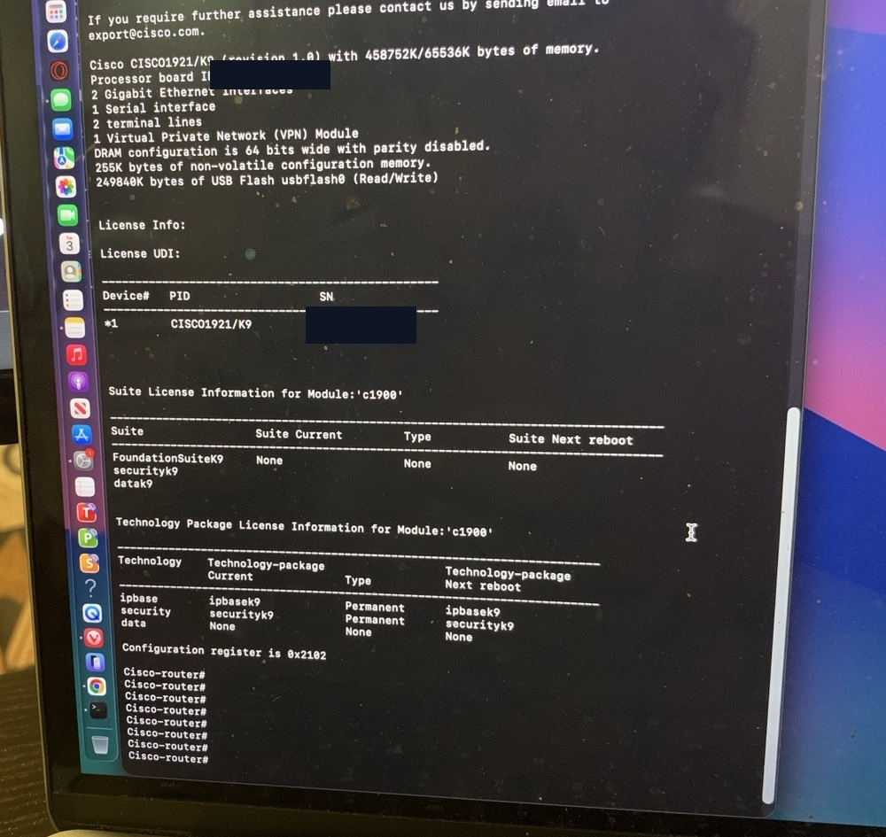
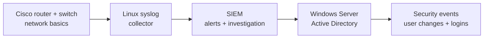

# 🔐 Cybersecurity Home Lab — 15-Day Build

**Status:** ✅ Day 1 complete · ⬜ Day 2 next  
**Focus:** Networking fundamentals → SIEM log monitoring → Windows Server & Active Directory

I'm documenting the process of building a small, isolated cybersecurity home lab using real Cisco hardware. The goal is to learn how devices communicate, collect and investigate security logs, and practice basic identity and access management.

> **Scope:** This is a learning environment, not a production network. The Cisco 1921 and Catalyst 3750G are legacy, out-of-support devices and will be kept behind the existing home network perimeter.

## 🎯 Day 1 of 15 — Console access and baseline inspection ✅

On Day 1, I used a MacBook Air and a USB-to-RJ45 console cable to reach the Cisco command-line interface (CLI) on both devices. I inspected the software/hardware information, interface state, and router logging output.

| Equipment | What I verified |
|---|---|
| Cisco 1921 router | Reached IOS CLI; inspected version, inventory, interface state, and logging |
| Cisco Catalyst 3750G switch | Reached IOS CLI; inspected version and interface states |
| MacBook Air | Used Terminal with `screen` to establish serial connections |
| USB-to-RJ45 console cable | Worked with both devices, moved between console ports |

### 🖥️ Console connection

Typical Mac command after finding the USB serial adapter:

```bash
ls /dev/cu.*
screen /dev/cu.usbserial-XXXX 9600
```

`XXXX` is a placeholder; actual serial device names vary.

**Serial settings:** 9600 baud, 8 data bits, no parity, 1 stop bit, no flow control.  
To exit `screen` safely: **Ctrl+A**, then **backslash (`\`)**, then **Y**.

### 🛠️ IOS commands used for the baseline

```text
enable
show version
show inventory
show ip interface brief
show logging
show running-config
```

The existing configuration was reviewed for learning, but **not published**. The console photo is cropped and redacted; the other observations are recorded as text.

### 🔎 Observations

- Both devices booted far enough to accept IOS CLI commands via the console.
- The switch displayed Cisco IOS **12.2(55)SE11** and interfaces named `Gi2/0/x` (member 2 numbering).
- In the switch snapshot, interfaces `Gi2/0/1` and `Gi2/0/2` reported **up/up**; many unused ports reported **down/down**.
- The router snapshot showed `Gi0/1` **up/up** and `Gi0/0` **down/down**.
- Router `show logging` reported syslog logging enabled. **This does not yet confirm remote SIEM ingestion.**
- IP addresses were present in the original configuration, but are deliberately omitted here.

**What this proves:** Console communication and basic IOS responses work. It **does not yet prove** that all switch ports, routing, Internet access, or end-to-end data forwarding work.

## 📸 Day 1 evidence

[Read the interface and logging observations](evidence/observations.md) for the switch and router results. The router console photo below shows the Cisco 1921 model and its two Gigabit Ethernet interfaces.



## 🗓️ The next milestones

| Day | Mission | Status |
|---|---|---|
| 1 | Connect to both Cisco devices and record the baseline | ✅ Completed |
| 2 | Inspect the Catalyst switch stack, port status, and VLANs | ⬜ Next |
| 3–6 | Test physical ports, design an isolated lab subnet, and verify connectivity | ⬜ Planned |
| 7–11 | Build a syslog collector and SIEM; generate and investigate test events | ⬜ Planned |
| 12–14 | Build Windows Server/Active Directory and inspect security events | ⬜ Planned |
| 15 | Publish a documented incident investigation and lab walkthrough | ⬜ Planned |

See [Day 1 journal](journal/day-01.md) for the lab log and [Day 2 checklist](journal/day-02-checklist.md) for the next commands.

## 🧭 Planned learning path



This is the **planned** workflow, not a claim that the SIEM or AD lab already exists.

## 🎥 Video journal

[Watch Day 0: Introduction to My Cybersecurity Homelab](https://youtu.be/_Dk3WzOfcEo) · [Day 1 recording notes](journal/day-01.md#day-1-video-journal-talking-points)

**Episode 1:** *Building My Cybersecurity Home Lab — First Cisco Console Connections*  
I documented how I accessed the Cisco 1921 and 3750G, checked IOS version and interface states, and learned why inspecting the current setup comes before reconfiguring it.

## 🔒 Safety and privacy

- The router photo is a **redacted copy**; original photos are not included.
- No passwords, full `running-config`, device serial numbers, Mac usernames, public IP addresses, or identifying device labels are intentionally published.
- Before sharing or pushing new screenshots, manually inspect them for credentials, serial numbers, addresses, MAC addresses, and personal information.
- Do not expose legacy Cisco management interfaces directly to the Internet.

*Learning portfolio: general educational use only.*
