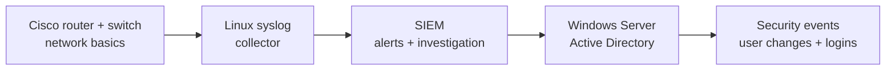

# 🔐 Cybersecurity Home Lab — 15-Day Build

**Status:** ✅ Days 1–3 complete · ⬜ Day 4 next  
**Focus:** Networking fundamentals → SIEM log monitoring → Windows Server & Active Directory

I'm documenting the process of building a small, isolated cybersecurity home lab using real Cisco hardware. The goal is to learn how devices communicate, collect and investigate security logs, and practice basic identity and access management.

> **Scope:** This is a learning environment, not a production network. The Cisco 1921 and Catalyst 3750G are legacy, out-of-support devices and will be kept behind the existing home network perimeter.

## ✅ Day 3 — Router-to-switch discovery and link health

I verified the connection between the Cisco 1921 router and Catalyst 3750G switch from both devices using Cisco Discovery Protocol (CDP). The router's `Gi0/1` interface maps to the switch's `Gi2/0/1` interface.

| Verification | Result |
|---|---|
| CDP discovery | Confirmed in both directions |
| Ethernet link | 1 Gbps, full duplex |
| Input / CRC / output errors | 0 / 0 / 0 |
| Interface resets | 1 historical |
| IP connectivity | Not tested yet |

Commands practiced:

```text
show cdp neighbors
show interfaces status
show interfaces gigabitEthernet2/0/1
```

**Key lesson:** A healthy Ethernet link and successful neighbor discovery do not automatically prove end-to-end IP communication. That is the Day 4 test.

[Read the complete Day 3 journal](journal/day-03.md)

## Previous milestones

- [Day 1 — Console access and baseline checks](journal/day-01.md)
- [Day 2 — Switch stack, port, and VLAN inspection](journal/day-02.md)
- [Day 3 — Router-to-switch connectivity and interface diagnostics](journal/day-03.md)

## 🗓️ The next milestones

| Day | Mission | Status |
|---|---|---|
| 1 | Connect to both Cisco devices and record the baseline | ✅ Completed |
| 2 | Inspect the Catalyst switch stack, port status, and VLANs | ✅ Completed |
| 3 | Verify the router-to-switch link with CDP and interface diagnostics | ✅ Completed |
| 4 | Verify isolated IP addressing and ping connectivity | ⬜ Next |
| 5–6 | Test physical ports and document the isolated lab subnet | ⬜ Planned |
| 7–11 | Build a syslog collector and SIEM; generate and investigate test events | ⬜ Planned |
| 12–14 | Build Windows Server/Active Directory and inspect security events | ⬜ Planned |
| 15 | Publish a documented incident investigation and lab walkthrough | ⬜ Planned |

## 🧭 Planned learning path



This is the **planned** workflow, not a claim that the SIEM or AD lab already exists.

## 🔒 Safety and privacy

- Public evidence uses cropped or redacted images.
- No passwords, full configurations, device serial numbers, usernames, public IP addresses, or MAC addresses are intentionally published.
- Legacy Cisco management interfaces will not be exposed directly to the Internet.

*Learning portfolio: general educational use only.*