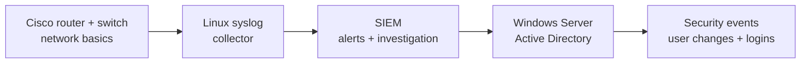

# 🔐 Cybersecurity Home Lab — 15-Day Build

**Status:** ✅ Days 1–4 complete · ⬜ Day 5 next  
**Focus:** Networking fundamentals → SIEM log monitoring → Windows Server & Active Directory

I'm documenting the process of building a small, isolated cybersecurity home lab using real Cisco hardware. The goal is to learn how devices communicate, collect and investigate security logs, and practice basic identity and access management.

> **Scope:** This is a learning environment, not a production network. The Cisco 1921 and Catalyst 3750G are legacy, out-of-support devices and will be kept behind the existing home network perimeter.

## ✅ Day 4 — Cisco log investigation and clock correction

I used the console connection to inspect the Catalyst 3750G's logging status and event history. The logs showed repeated link-state changes on `Gi2/0/2` and timestamps from 1993. `show clock detail` confirmed that the switch had no synchronized time source.

I used the MacBook's current UTC time to set the switch clock manually, then verified the correction and found the resulting `%SYS-6-CLOCKUPDATE` event in the Cisco log buffer.

| Investigation | Result |
|---|---|
| Local logging | Enabled |
| Link events | Repeated `%LINK-3-UPDOWN` and `%LINEPROTO-5-UPDOWN` on `Gi2/0/2` |
| Original clock | March 1993; no time source |
| Corrected clock | November 10, 2026; user configured |
| Verification | `%SYS-6-CLOCKUPDATE` recorded |
| MacBook ping test | Pending until a USB-to-Ethernet adapter is available |

**Key lesson:** Reliable timestamps are essential for correlating events across network devices and a SIEM. Manual clock setting helps, but NTP is needed for ongoing synchronization.

[Read the complete Day 4 journal and view the evidence](journal/day-04.md)

## Previous milestones

- [Day 1 — Console access and baseline checks](journal/day-01.md)
- [Day 2 — Switch stack, port, and VLAN inspection](journal/day-02.md)
- [Day 3 — Router-to-switch connectivity and interface diagnostics](journal/day-03.md)
- [Day 4 — Cisco log analysis and clock correction](journal/day-04.md)

## 🗓️ The next milestones

| Day | Mission | Status |
|---|---|---|
| 1 | Connect to both Cisco devices and record the baseline | ✅ Completed |
| 2 | Inspect the Catalyst switch stack, port status, and VLANs | ✅ Completed |
| 3 | Verify the router-to-switch link with CDP and interface diagnostics | ✅ Completed |
| 4 | Investigate Cisco logs and correct unreliable timestamps | ✅ Completed |
| 5 | Compare router and switch logging; plan NTP and centralized collection | ⬜ Next |
| 6 | Complete isolated IP connectivity testing when the Ethernet adapter is available | ⬜ Planned |
| 7–11 | Build a syslog collector and SIEM; generate and investigate test events | ⬜ Planned |
| 12–14 | Build Windows Server/Active Directory and inspect security events | ⬜ Planned |
| 15 | Publish a documented incident investigation and lab walkthrough | ⬜ Planned |

## 🧭 Planned learning path

This is the **planned** workflow, not a claim that the SIEM or AD lab already exists.

## 🔒 Safety and privacy

- Public evidence uses cropped or redacted images.
- No passwords, full configurations, device serial numbers, usernames, public IP addresses, or MAC addresses are intentionally published.
- Legacy Cisco management interfaces will not be exposed directly to the Internet.

*Learning portfolio: general educational use only.*