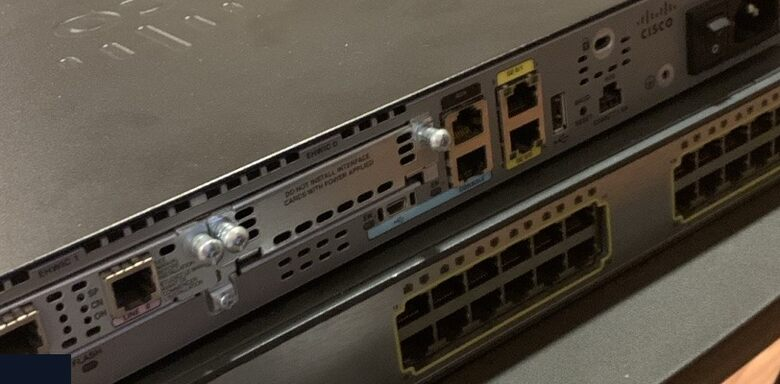
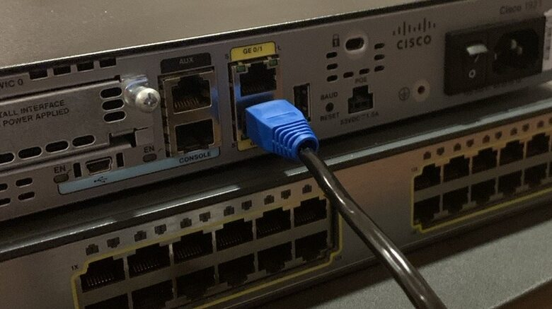
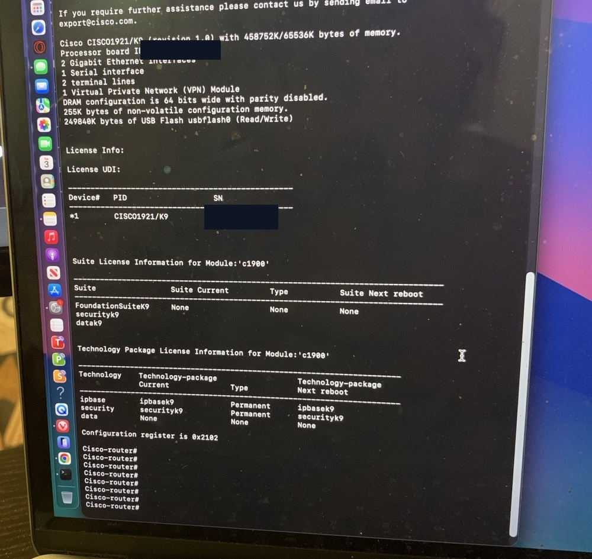
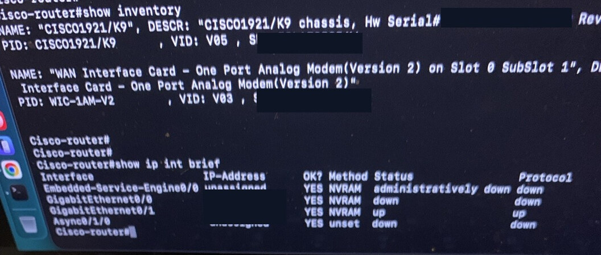
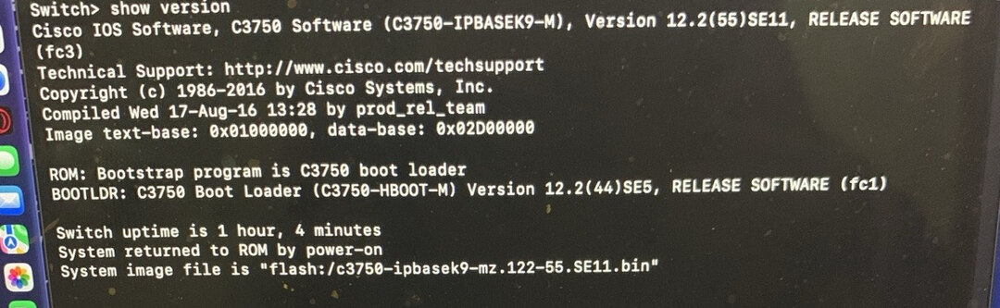
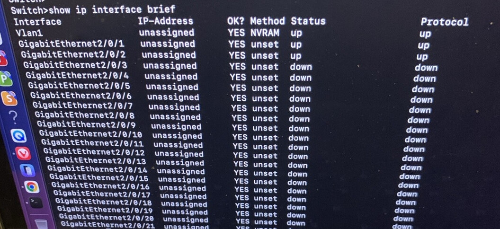

# Day 1 — Cisco homelab photo journal

[Read the Day 1 lab journal](../journal/day-01.md) · [View the interface and logging results as text](observations.md)

## Hardware and cabling

**1. The physical lab.** The Cisco 1921 router sits above the Catalyst 3750G switch. The rows of Ethernet ports on the lower device are the ports I inspected on the switch.

**2. Ethernet and console ports.** The blue plug is in an Ethernet jack. The separate jack labeled `CONSOLE` to its left is where I connected the MacBook's console cable to manage the router.

## Router console

**3. Identifying the router.** The console output lists the model as `CISCO1921/K9` and reports two Gigabit Ethernet interfaces.

**4. Checking the router links.** I ran `show inventory` and `show ip interface brief`. At the time of the check, `Gi0/1` showed up/up and `Gi0/0` showed down/down.

## Switch console

**5. Checking the software.** The switch's `show version` output identifies Cisco IOS version `12.2(55)SE11`.

**6. Finding the switch ports.** The first two physical ports listed are `Gi2/0/1` and `Gi2/0/2`. Both showed up/up. That output gave me the port names to use in my next lab.

[Back to the project overview](../README.md)
