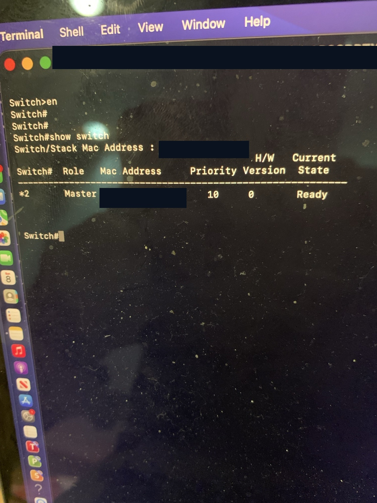
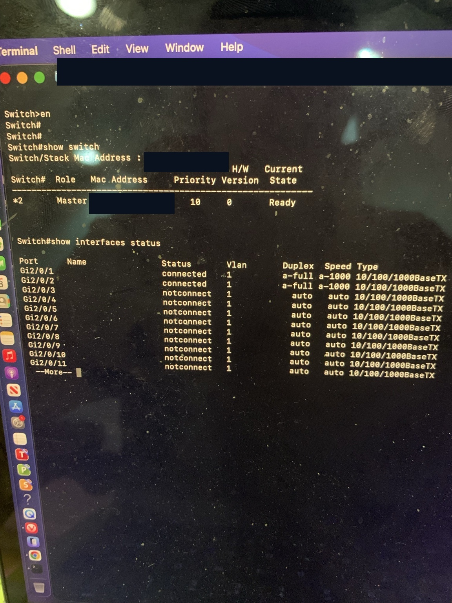
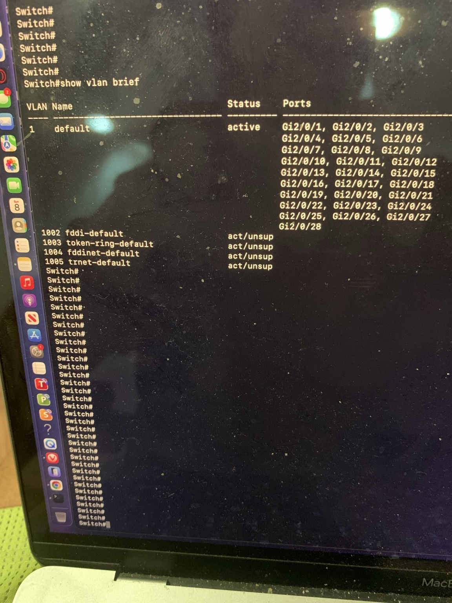

# Day 2 — Cisco Catalyst 3750G Inspection ✅

**Project:** Cybersecurity Home Lab (15-day journal)  
**Focus:** Basic switch configuration discovery and troubleshooting  
**Status:** Completed three read-only inspection missions

## Mission objective

Learn how to interpret a real Cisco Catalyst 3750G's stack membership, link status, and VLAN membership before making any changes or connecting the lab to the home production network.

## Commands used

I accessed the switch via the USB-to-RJ45 console cable and macOS Terminal, then entered:

```text
enable
show switch
show interfaces status
show vlan brief
```

No configuration-changing commands were used during this mission.

## Mission 1 — Switch stack discovery

**Command:** `show switch`

- Only **member 2** appeared in the displayed stack table.
- **Role:** `Master`
- **Priority:** `10`
- **Current state:** `Ready`
- **H/W version field:** `0`

**Interpretation:** The switch is reporting itself as the active stack master and ready. Its switch-number 2 assignment explains why interfaces are named `Gi2/0/1` and so on. The number is not an error by itself, and no renumbering was necessary.



## Mission 2 — Ethernet link checks

**Command:** `show interfaces status`

| Port(s) | Status in the screenshot | VLAN | Duplex / Speed |
|---|---|---|---|
| `Gi2/0/1` | `connected` | 1 | `a-full` / `a-1000` |
| `Gi2/0/2` | `connected` | 1 | `a-full` / `a-1000` |
| `Gi2/0/3`–`Gi2/0/11` | `notconnect` | 1 | `auto` / `auto` |

The output was paused at `--More--`; the remaining port statuses were not visible in this screenshot. **Do not assume that all other ports were tested.**

**Interpretation:** Two ports had active 1 Gbps, full-duplex Ethernet links. This is an encouraging hardware check, but it doesn't prove end-to-end packet forwarding or that every physical port works.



## Mission 3 — VLAN inspection

**Command:** `show vlan brief`

- VLAN **1**, named `default`, was **active**.
- The VLAN table listed the switch interfaces **`Gi2/0/1` through `Gi2/0/28`** under VLAN 1.
- Legacy VLANs **1002**, **1003**, **1004**, and **1005** were shown as `act/unsup`.
- No custom VLANs were displayed in this output.

**Interpretation:** At the time of inspection, all 28 interfaces appeared in the default VLAN 1. VLAN membership is not the same as having an Ethernet device connected to each port. VLAN 1002–1005 are legacy defaults on this IOS family.



## What I learned

1. `show switch` describes the switch stack's members, roles, priorities, and readiness.
2. A switch can have member number **2** even if only one stack member is present.
3. `connected` and `a-1000` describe physical link negotiation, not successful IP routing.
4. `show vlan brief` shows VLAN membership and helps discover whether segmentation is already configured.
5. **Inspect first, configure second** is a useful habit for secure network administration.

## Security monitoring connection

This information establishes a baseline for future SIEM investigation. Later, when syslog is collecting events from the switch, I can compare reported link-state or VLAN-related changes with these original observations.

**Not done yet:** Syslog forwarding to a collector, SIEM ingestion, packet capture, ACL tests, VLAN segmentation, end-to-end network connectivity, or a full hardware port test.

## Next — Day 3

- Verify what equipment is plugged into `Gi2/0/1` and `Gi2/0/2`.
- Inspect the existing Cisco router and switch configuration before changing it.
- Test lab Ethernet links and IP connectivity in an isolated environment.
- Keep the Cisco lab separated from the production home network until the topology, addressing, and security settings are understood.

## Evidence privacy

Screenshots were cropped or covered with opaque redaction to omit the MacBook username and switch MAC address. Device serial numbers and IP addresses are not included in these Day 2 images. Review any future images before public posting.

## Video journal

**Episode 2:** *Exploring My Cisco 3750G Switch — Stack, Ports, and VLANs*

Suggested outline: show command → explain observed result → explain why it matters → preview a Day 3 connectivity test.
