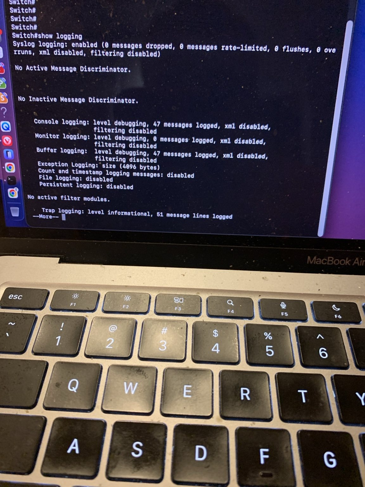
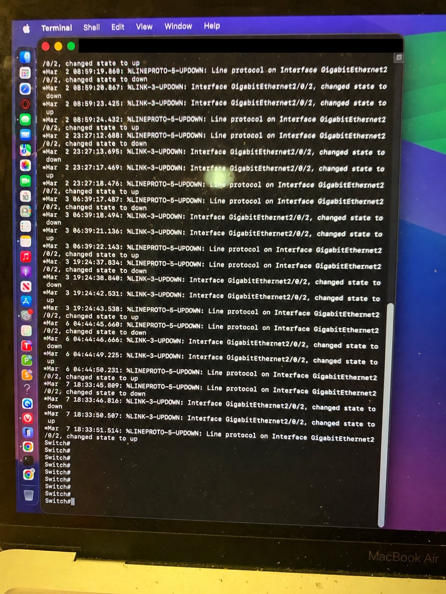
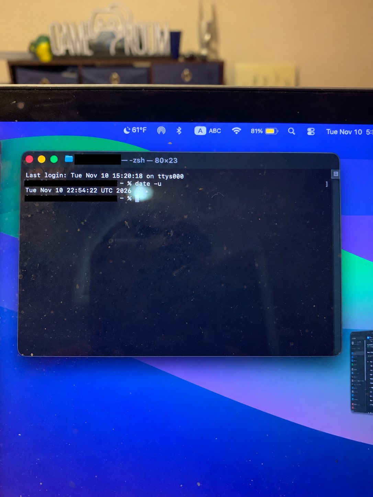
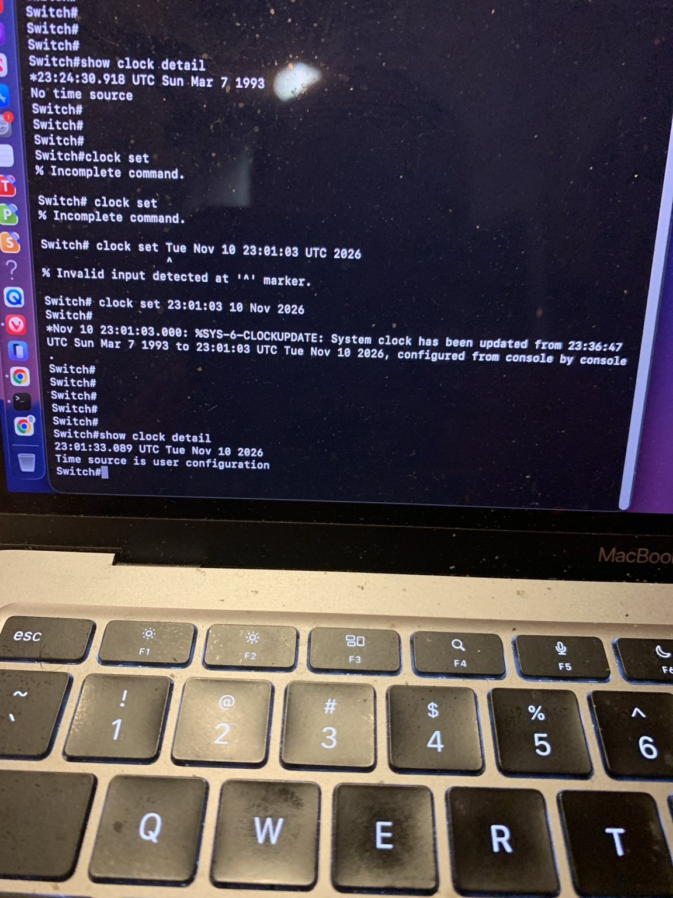
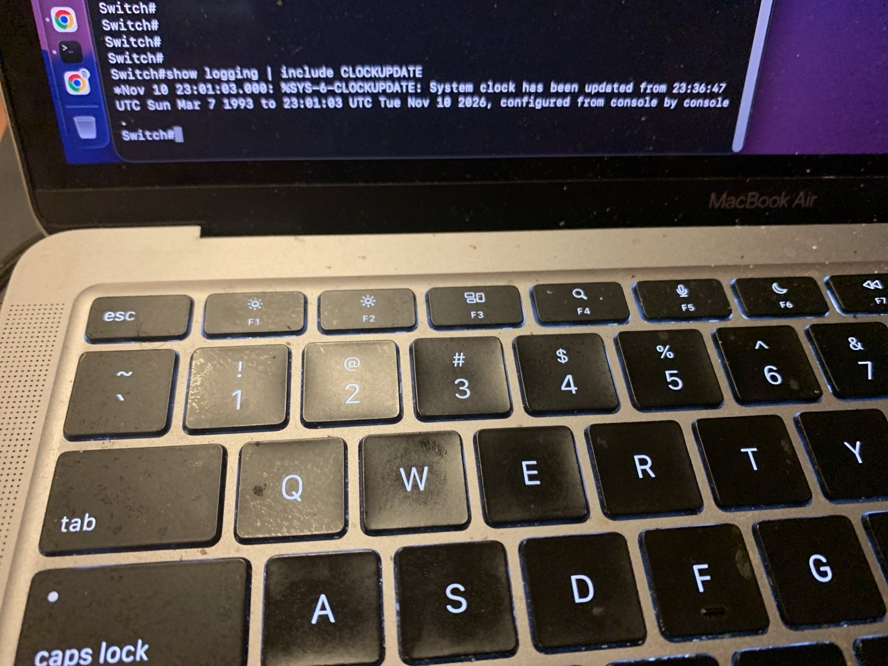

# Day 4 — Investigating Cisco Logs and Correcting System Time ✅

**Project:** Cybersecurity Home Lab (15-day journal)  
**Focus:** Cisco syslog analysis, timestamp reliability, and clock correction  
**Status:** Console-only mission completed; Ethernet ping test deferred

## Mission objective

Inspect the Catalyst 3750G's logging status and buffered events, investigate unreliable timestamps, correct the switch clock through the console, and verify that Cisco IOS recorded the change.

## Lab constraint

I currently have the Cisco USB console cable but not a USB-to-Ethernet adapter. The planned MacBook-to-lab ping test remains pending. I used the console connection to complete a useful security-log investigation without changing the lab's Ethernet configuration.

## Commands used

```text
show logging
show clock detail
clock set HH:MM:SS DD Mon YYYY
show logging | include CLOCKUPDATE
```

On the MacBook, I used `date -u` to obtain the current UTC time before setting the switch clock.

## Results

| Check | Observation | Interpretation |
|---|---|---|
| Syslog status | Logging enabled | The switch records local events |
| Buffered events | 47 messages shown in the captured status | Local event history was available for review |
| Trap logging | Informational level; 51 message lines logged | This alone does not prove delivery to an external server |
| Interface events | Repeated `%LINK-3-UPDOWN` and `%LINEPROTO-5-UPDOWN` for `Gi2/0/2` | The port repeatedly disconnected and reconnected |
| Original clock | `Sun Mar 7 1993`; `No time source` | Existing timestamps were unreliable |
| Corrected clock | `Tue Nov 10 2026`; user configuration | Future events use a more useful manually set time |
| Verification event | `%SYS-6-CLOCKUPDATE` | Cisco IOS recorded the clock change |

## Investigation notes

The repeated `Gi2/0/2` down/up events could have been caused by cable reconnection, a connected device restarting, or an intermittent physical connection. They are **not evidence of a cyberattack by themselves**. A security analyst needs more context before classifying the cause.

The `6` in `%SYS-6-CLOCKUPDATE` identifies an informational event. The leading `*` on timestamps indicated the switch did not consider its time synchronized to a trusted source.

## What I learned

1. **Detection:** I noticed log timestamps reporting 1993.
2. **Investigation:** I checked the clock and found `No time source`.
3. **Correction:** I manually set the switch to the current UTC date and time.
4. **Verification:** I found the `%SYS-6-CLOCKUPDATE` event in the log buffer.
5. **Analysis:** I treated repeated link-state changes as evidence to investigate, not automatic proof of an attack.

Manual clock setting improves future timestamps, but it is not a replacement for NTP. The clock can drift or reset, and old log timestamps are not repaired automatically.

## Photo evidence

Public copies hide the Mac username and serial-device path while preserving the command results.












## Next — Day 5

Inspect logging settings on the router, compare both Cisco devices, and plan reliable NTP plus centralized log collection before sending events to a SIEM.